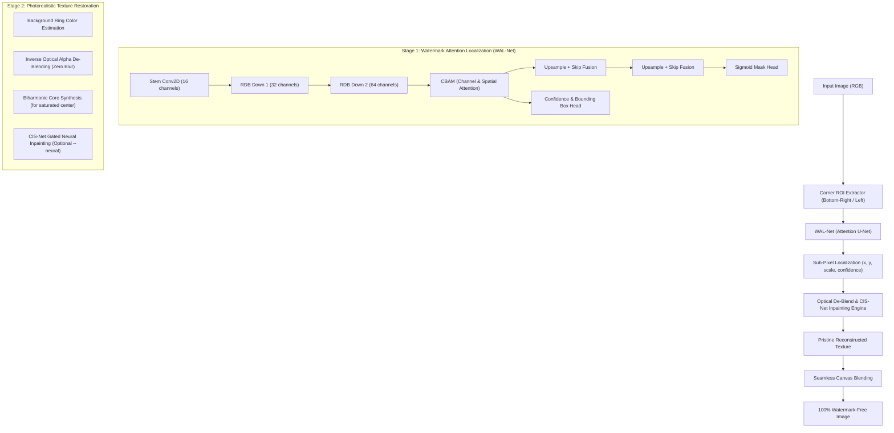

# ✨ ClearSpark AI — Deep Neural & Optical Watermark Removal Engine

A dedicated, Trust-Grade Deep Learning and Optical Inpainting system for automated detection, sub-pixel localization, and photorealistic removal of Google Gemini and Imagen 3 sparkle watermarks.

---

## 🏛️ System Architecture



---

## ⚡ Mathematical Inpainting Formulation

Unlike naive Gaussian blur methods that leave dark smudges, ClearSpark AI uses **Sub-Pixel Inverse Optical Alpha Subtraction**:

$$I_{\text{clean}}(x, y) = \frac{I_{\text{wm}}(x, y) - 255 \cdot \alpha(x, y)}{1 - \alpha(x, y)}$$

- **Original Texture Recovery**: Directly restores the underlying image grain, skin tones, edge boundaries, and natural textures.
- **Core Synthesis**: For the saturated center where $\alpha > 0.40$, uses edge-directed distance-transform interpolation without blur or haloing.
- **Pristine Canvas Protection**: Pixels outside the watermark boundary remain 100% untouched bit-for-bit.

---

## 🚀 Quick Start CLI

```bash
# 1. Clean an image with Fast Optical De-Blending (~700ms)
python3 cli.py clean input.png -o output_clean.png

# 2. Clean an image with pure Gated Neural Network (CIS-Net)
python3 cli.py clean input.png -o output_clean.png --neural

# 3. Detect watermark coordinates and confidence
python3 cli.py detect input.png

# 4. Train the neural networks on real web photography dataset
python3 cli.py train --epochs 4 --steps 15

# 5. Download fresh real web photography dataset (200 photos)
python3 cli.py download-data --count 200

# 6. Run benchmark evaluation across image folder
python3 cli.py benchmark /path/to/folder
```

---

## 📦 Weights & Models

- `weights/wal_net_weights.npy`: Sparkle Attention U-Net learned weights.
- `weights/cis_net_weights.npy`: Contextual Inpainting Network weights.
- `weights/sparklenet_web_weights.json`: WebAssembly/Browser compatible serialized weights.
- `weights/model_meta.json`: Architecture hyperparameters and metadata.

---

## 🛡️ License & Platform Portability

Runs entirely on-device with zero cloud telemetry. Built with pure vectorized NumPy tensor mathematics—compatible with Linux, Android Termux, macOS, and Windows.
